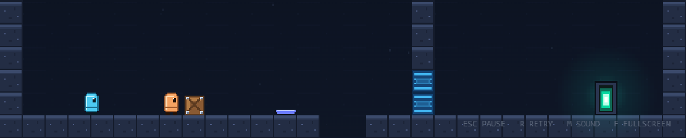

# Coop Puzzle

Two players, one keyboard. A local co-op puzzle platformer that runs in the browser.

Five hand-made levels, a shared auto-zooming camera, and a rule set built around
talking to the person sitting next to you. No server, no accounts, no external
art or audio files: every sprite and sound is generated in code.



## Play

| Player | Move      | Jump           |
| ------ | --------- | -------------- |
| P1     | `A` / `D` | `W` or `Space` |
| P2     | `←` / `→` | `↑` or `Enter` |

`R` retries the level · `Esc` pauses · `M` mutes audio · `F` fullscreen. Menus
work with the arrow keys and `Enter`, or with the mouse.

On phones and tablets the game shows one thumb pad per player in landscape, plus
pause and fullscreen buttons. Both players share the same screen and device.

The goal is always the same: **both players must stand in the exit**. One player
in the exit is captured and waits for the other.

## Mechanics

- **Pressure plates** open a door only while something heavy is on them.
- **Crates** can be pushed and are heavy enough to hold a plate for good.
- **Levers** latch on the first touch and never turn off.
- **Doors** share a letter with their plate or lever (`a` opens `A`).
- **Spikes** and falls restart the level; a crate lost in a pit respawns so the
  puzzle can never become unsolvable.
- **Shared camera** keeps both players on screen and zooms out when they split up.
- **Progress** and best times are stored in `localStorage` on this device.

## Levels

| #   | Name           | Idea                                                           |
| --- | -------------- | -------------------------------------------------------------- |
| 01  | First Steps    | Hold a plate for your partner, then swap roles                 |
| 02  | Heavy Lifting  | Push a crate onto a plate, then jump the gap                   |
| 03  | Switchboard    | A lever stays on; one player can open the way for both         |
| 04  | Two-Way Street | Two floors, two plates, two doors; each player helps the other |
| 05  | The Finale     | Crate, lever, spikes and two doors at once                     |

## Stack

- **Phaser 4** for scenes, cameras and arcade physics.
- **TypeScript** in `strict` mode with `noUncheckedIndexedAccess`.
- **Vite** for the dev server and static build.
- **Vitest** for the framework-free game logic.
- **ESLint + Prettier**, GitHub Actions CI and a GitHub Pages deploy workflow.

## Getting started

```bash
npm install
npm run dev        # http://localhost:5173
```

Other scripts:

```bash
npm run build      # typecheck + production build into dist/
npm run preview    # serve dist/ locally
npm run typecheck
npm run lint
npm test
npm run format
```

Best played with two people on one full-size keyboard.

## Architecture

The gameplay rules are deliberately kept out of Phaser objects:

- `src/game/level/parseLevel.ts` turns an ASCII map into collision rectangles,
  spawns, linked doors, plates, levers, crates, spikes and the exit zone.
- `src/game/systems/jump.ts` owns coyote time and the jump buffer as pure functions.
- `src/game/systems/cameraView.ts` computes the shared camera zoom and scroll
  without importing Phaser, so it can be unit-tested in Node.
- `src/game/systems/progress.ts` validates and persists progress; corrupt storage
  always falls back to a fresh save.
- `src/game/systems/touch.ts` builds the on-screen pads and the pause/fullscreen
  buttons, writing into the same per-player input the keyboard uses.
- `LevelScene` connects those systems to Phaser, while `HudScene` owns the
  timer, pause overlay and level-clear overlay.

```
src/
  main.ts                 entry point, audio unlock, dev-only game handle
  style.css               page shell around the canvas
  game/
    config.ts             Phaser config: 480x270, Scale.FIT, pixelArt
    constants.ts          resolution, tile size, physics tuning, palette
    assets/textures.ts    every texture and animation, drawn at boot
    entities/             Player, Crate
    level/                ASCII parser + the five level maps
    scenes/               Boot, Menu, LevelSelect, HowTo, Level, Hud
    systems/              input, jump, camera, audio, progress, touch, actions
    ui/                   keyboard-first NavList, panels, backdrop, theme
    util/                 small framework-free helpers
tests/                    Vitest specs for pure logic
```

## Design decisions

- **480×270 design grid, 960×540 render buffer.** Levels and UI lay out in the
  small grid, but the canvas renders at twice that size and every camera zooms by
  two. World art stays chunky pixel art; text is rasterised at a readable size
  instead of being magnified, which is what keeps the UI sharp on a big screen.
- **Shared camera, not split-screen.** Puzzles are about planning out loud. A
  split screen would hide the other player's half of the solution.
- **Touch pads reuse the keyboard input path.** `touch.ts` writes into the same
  per-player state the key bindings feed, so movement, coyote time and the jump
  buffer behave identically on a phone.
- **Levels are data, not code.** `docs/level-format.md` documents every tile and
  the parser rejects broken maps with a readable error instead of shipping them.
- **All art and audio are generated.** Textures are canvas drawings created at
  boot; music and effects are Web Audio oscillators and noise. The build has no
  image, font or sound assets to download.
- **Movement forgiveness.** 100 ms of coyote time, a 120 ms jump buffer, variable
  jump height and a slightly narrower collision box keep the platforming fair.
- **Crates feel direct.** Players are not `pushable` in arcade physics, so their
  full speed transfers to a crate. If both bodies were pushable, Phaser would
  average their velocities and a heavy crate would crawl.

## Testing

```bash
npm test           # 52 unit tests: parser, levels, progress, jump, camera, math
npm run typecheck
npm run lint
```

The shipped levels are validated in `tests/levels.test.ts`: rectangular, 17 rows
tall, every door linked to a source and every source linked to a door. During
development the game was also driven through Chrome DevTools Protocol with real
key events and pointer events to verify plate/door behaviour, crate pushing,
lever latching, camera zoom, pause/retry, level completion, persistence and the
touch pads. The production build strips the dev-only `window.__coopGame` handle.

`docs/ai/` holds the brief for AI coding models: ground rules, coordinate
systems, verification recipes and the task breakdown.

## Authoring levels

See [`docs/level-format.md`](docs/level-format.md) for the tile legend, parser
validation and a solvable example. Add a map to `LEVELS` in
`src/game/level/levels.ts`; the tests pick it up automatically.

## Deploying

The build uses a relative base path, so it works on GitHub Pages under any
repository name. Push to `main` and `.github/workflows/deploy.yml` builds and
publishes `dist/`. Enable it once in **Settings → Pages → Source: GitHub Actions**.

## Credits

Built with [Phaser 4](https://phaser.io/), [TypeScript](https://www.typescriptlang.org/),
[Vite](https://vite.dev/) and [Vitest](https://vitest.dev/). All in-game art and
audio are generated by this project; no third-party asset packs are used.
